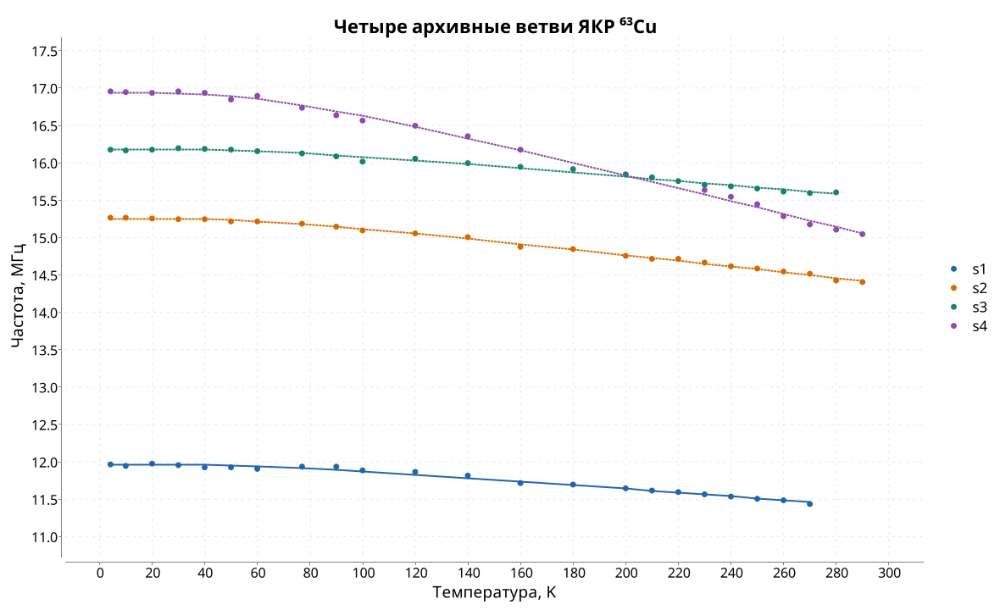
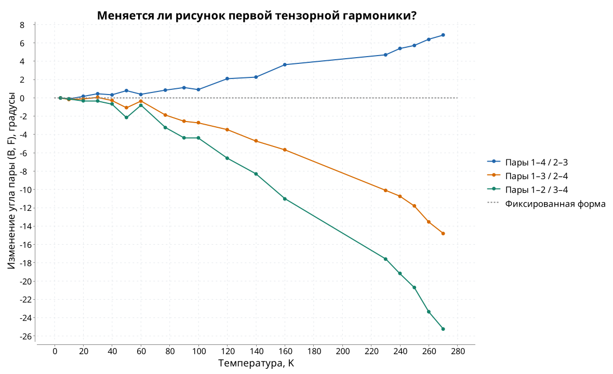
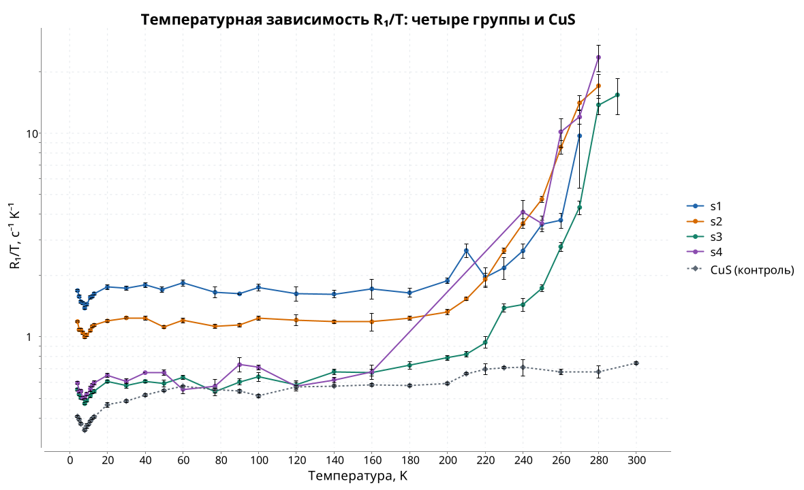
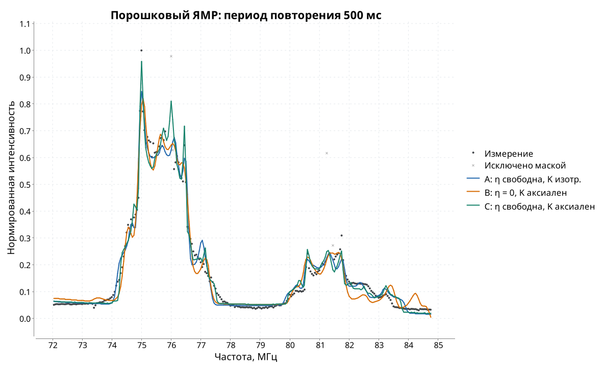

# Четыре группы Cu ЯКР: температурный тензор, релаксация и анизотропный ЯМР

Расчётное продолжение от 28 ноября 2026 года. Исходный снимок репозитория:
27b3daae5022e97bba995e20bd4e3f5a99394766.

## 1. Главные результаты и область применимости

Проверены три связанные гипотезы: происхождение четырёх ветвей от общего
родительского тензора ГЭП, наличие общего динамического процесса в
релаксации и устойчивость порошкового определения асимметрии ГЭП к
анизотропии магнитного сдвига. Все новые расчётные модули написаны на
Java 17/Maven; полные формулы, исходные таблицы, промежуточные величины и
проверки сохранены рядом с кодом.

Уже на уровне температурных и релаксационных данных получены содержательные
ограничения:

- Общий температурный ход четырёх частот хорошо описывается одной
  функцией с индивидуальными исходными частотами. Более сильная гипотеза
  о единственном множителе общего расщепления описывает данные хуже.
- Для периода четыре выведены необходимые связи между квадратами частот.
  Направление первой гармоники меняется с температурой при каждом из
  трёх глобальных назначений противоположных пар. Простейший фиксированный
  тензорный профиль не воспроизводит эту эволюцию точно.
- Нелинейный высокотемпературный рост R₁ подтверждается, но активационная
  форма не выделяется: степенной контроль с тем же числом параметров
  несколько лучше по выбранным описательным критериям.
- Однолоренцева BPP-модель не определяет отдельное время попытки:
  оно компенсируется амплитудой флуктуаций на широком плато параметров.
- В R₂ обнаружены совпадающие и конфликтующие архивные записи.
  Их неоднозначность влияет на проверку перекрёстной релаксации и
  сохранена в расчёте явно.
- Анизотропный магнитный сдвиг улучшает найденное совместное описание
  ЯМР: SSE уменьшается на 39.44% при четырёх дополнительных параметрах.
  Значения η при этом меняются; их нельзя считать независимыми от
  модели магнитного отклика.

Метки s1–s4 обозначают спектральные группы. Они не равны назначенным
кристаллографическим Cu1–Cu5. Историческое название фазы в исходном
дипломе сохранено в происхождении данных; новые феноменологические
подгонки не определяют фазу независимо от дифракции. В частности,
температура измерения сама по себе не доказывает низкотемпературный
дигенит. Ориентиром идентификации остаётся сообщённая экспериментатором
повторная рентгеновская проверка анилита.

## 2. Какие независимые данные действительно имеются

| Данные | Использованный объём | Ограничение |
|---|---|---|
| Частоты ⁶³Cu ЯКР | 89 значений, 24 температуры 4.2–290 K | Только 18 полных квартетов; s4 отсутствует при 180–220 K |
| R₁ четырёх групп | 115 архивных значений | Нет исходных recovery-кривых M(t); анализируются прежние оценки скоростей |
| R₁ CuS | 29 значений отдельной серии | Контроль другой фазы, не пятая группа совместной модели |
| Высокотемпературная модель R₁ | 66 значений при T≥50 K | Все сравниваемые экспоненциальные и степенные модели используют одинаковый набор |
| Изотопные R₁ | Два отношения ⁶⁵Cu/⁶³Cu при 4.2 K | Нет сохранённых ошибок второго изотопа |
| Порошковый ЯМР | Два спектра при периодах повторения 20 и 500 мс | Общие параметры гамильтониана; независимые отклики групп и фон |

Частотные столбцы ⁶⁵Cu получены делением ⁶³Cu на 1.081. Они полезны
для построения модели, но не добавляют независимых измеренных частот.
Столбец, названный T1T, в 144 общих точках точно совпадает с R₁/T:
это повторное представление тех же данных. Лишняя точка s4 при 290 K,
присутствующая лишь в производной таблице, сохранена отдельно и не
включена в подгонку.

Для частот нет надёжно установленных ошибок центров линий; у сохранённых
ErrW1 неизвестна конвенция доверительного уровня. Поэтому далее
показываются остатки, прогнозные ошибки и чувствительность к
предположениям. Они не называются χ², p-values или доверительными
интервалами.

## 3. Общий температурный ход и происхождение от одной позиции

### Две разные математические гипотезы

Модель

\[
\nu_i(T)=a_i+b_iF(T)
\]

имеет четыре независимые постоянные частоты и одну произвольную общую
температурную функцию. После удаления среднего каждого столбца матрица
частот должна иметь ранг один. На 18 полных квартетах её остаток равен
**0.017603 МГц**, а первая компонента описывает 99.777% квадратной нормы
температурных изменений.

Более сильная модель

\[
\nu_i(T)=\mu(T)+b_i\psi(T),\qquad \sum_i b_i=0
\]

предполагает, что весь рисунок расщепления вокруг общего среднего
изменяется одним множителем. После удаления среднего при каждой
температуре нужен ранг один. Её остаток **0.143077 МГц**. При исключении
любой одной температуры разрыв между двумя описаниями сохраняется.

Первый результат совместим как с родственными подъячеечными окружениями,
так и с несколькими обычными позициями, испытывающими общее тепловое
воздействие. Он не выбирает между этими возможностями. Второй результат
ограничивает простую скалярную версию общего расщепления, но ещё не
проверяет полный тензор.

### Явная температурная функция и проверка прогноза

Для всех 89 частот рассмотрена эффективная функция Бозе:

\[
\nu_i(T)=a_i+b_i n_B(T;\Theta),\qquad
n_B=\frac{1}{\exp(\Theta/T)-1}.
\]

Нулевая колебательная поправка поглощена в aᵢ. Общая Θ сравнивается с
четырьмя отдельными Θᵢ и феноменологическим T². Все параметры заново
определялись при исключении целых диапазонов 4.2–60, 77–160, 180–220
и 230–290 K.

| Закон, исходное прослеживание ветвей | Параметров | RMS полного описания, МГц | RMS исключённых диапазонов, МГц |
|---|---:|---:|---:|
| Общая Θ | 9 | 0.024880 | 0.065101 |
| Четыре Θᵢ | 12 | 0.024016 | 0.080466 |
| T² | 8 | 0.039856 | 0.162779 |

Общая **Θ=188.665 K** достаточна для этого класса описаний; отдельные
шкалы не улучшили прогноз. При исключении диапазонов общая Θ меняется
примерно от 158 до 287 K, поэтому её нельзя назначить конкретному фонону.
Температурная поправка к ГЭП вообще включает статическое изменение
структуры и колебательные вклады; их совместная роль продемонстрирована
в первичных расчётах для других веществ [1,2]. Эти источники обосновывают
ограничение интерпретации, а не устанавливают механизм именно в Cu–S.

Точки — архивные частоты; линии — совместная функция Бозе. Линия модели
в области пропуска s4 не является восстановленным измерением.

Перестановка меток s3/s4 при T≥230 K проверена как отдельная заранее
заданная гипотеза. Она повышает ошибку общей функции Бозе на исключённых
диапазонах до 0.177533 МГц. Исходное прослеживание лучше согласуется с
гладким общим ходом. Однако это не заменяет повторного разделения
спектральных линий в области их сближения.

## 4. Более строгая проверка: полный тензор общего родителя

Для I=3/2 частота нулевого поля определяет норму бесследового
симметричного тензора:

\[
\nu=\frac{|eQV_{zz}|}{2h}\sqrt{1+\eta^2/3},
\qquad
\nu^2=\frac{(eQ)^2}{6h^2}\operatorname{Tr}(V^2).
\]

Поэтому синусоидальная модуляция V не обязана давать синусоидальную ν.
Это принципиальная причина перехода от прежнего скалярного упражнения
к квадратам частот.

Рассмотрен конкретный период четыре:

\[
V_m(T)=v(T)U+\psi(T)
\left[C\cos(\pi m/2)+S\sin(\pi m/2)\right],
\quad m=0,1,2,3.
\]

В этой модели U,C,S имеют фиксированную форму; меняются только v и ψ.
Она допускает изменение η и главных осей полного Vₘ. Масштаб ядерного
множителя ниже поглощён в тензоры. Введём xₘ=νₘ²:

\[
\bar x=\frac{x_0+x_1+x_2+x_3}{4},\quad
B=\frac{x_0-x_2}{2},\quad
F=\frac{x_1-x_3}{2},\quad
D=\frac{x_0-x_1+x_2-x_3}{4}.
\]

Раскрытие квадрата нормы даёт

\[
\bar x=av^2+e\psi^2,\quad B=bv\psi,\quad F=cv\psi,\quad D=d\psi^2,
\]

где a=‖U‖², b=2U·C, c=2U·S,
d=(‖C‖²−‖S‖²)/2, e=(‖C‖²+‖S‖²)/2.
Отсюда следуют необходимые условия:

\[
\frac FB=\mathrm{const},\qquad
\operatorname{sign}D=\mathrm{const},\qquad
\bar xD=\alpha(B^2+F^2)+\beta D^2,
\]

\[
\alpha=\frac{ad}{b^2+c^2},\qquad \beta=\frac ed.
\]

Реализуемость реальными тензорами дополнительно требует

\[
\operatorname{sign}\alpha=\operatorname{sign}\beta=\operatorname{sign}D,
\quad|\beta|\ge1,\quad
\alpha(\beta+1)\ge\frac p4,\quad
\alpha(\beta-1)\ge\frac{1-p}{4},
\quad p=\frac{b^2}{b^2+c^2}.
\]

Полный вывод, условия применимости и условная физическая
проекция даны в [аналитическом отчёте модуля](../joint_temperature/ANALYSIS_RU.md).
Проверены все три глобальных назначения противоположных пар, а не
новый порядок для каждой температуры.

| Противоположные пары, исходные метки | Размах направления (B,F) | Эквивалентный RMS частоты при проекции первой гармоники |
|---|---:|---:|
| s1–s4 / s2–s3 | 7.0147° | 0.057860 МГц |
| s1–s3 / s2–s4 | 14.8790° | 0.123654 МГц |
| s1–s2 / s3–s4 | 25.2273° | 0.142799 МГц |

Для первого класса F/B изменяется от 0.195820 до 0.326738.
Эта проверка минимизирует остаток необходимого условия в пространстве
квадратов частот, а не выполняет полный оптимальный атомный fit.
Смена меток s3/s4 несколько улучшает отдельные тензорные проверки, но
ухудшает гладкий температурный прогноз; нельзя выбирать метки отдельно
под каждую желаемую гипотезу.

На вертикальной оси — угол в плоскости двух коэффициентов (B,F).
Это **не угол поворота атома или осей ГЭП**. Нулевая горизонталь была
бы признаком фиксированного направления этой гармоники.

Знак D и ограничения Gram проходят, но направление первой гармоники
не остаётся постоянным. Для трёх исходных классов конкретная условная
физическая проекция даёт RMS около 0.146–0.175 МГц. Это не глобальный
минимум всех допустимых тензоров и не статистическое исключение при
неизвестных ошибках центров.

Физический вывод: если четыре группы действительно происходят от
одного родителя, полезно проверять дополнительную структурную моду,
высшие пространственные гармоники, изменение фазы или формы
родительского тензора. Четыре частоты сами по себе не восстанавливают
ни атомные смещения, ни знак Vzz, ни ориентации тензоров.

## 5. Релаксация: что выделяется и что остаётся модельным

Полосы ошибок сохраняют исходные ErrW1; соединяющие линии служат
визуальными направляющими. Низкотемпературная часть показана отдельно
в [увеличенном графике](figures/r1_over_t_low_temperature.png).
Минимум R₁/T около 7–8 K виден также в контрольной серии CuS.
Само совпадение его температуры не выделяет переход основной фазы:
нужно различить общий физический эффект и систематику измерения.
Следующие высокотемпературные модели этот минимум не описывают.

Для T≥50 K сравнивались:

\[
R_{1,i}=a_iT,
\]
\[
R_{1,i}=a_iT+C_i\exp[-\Theta(1/T-1/250)],
\]
\[
R_{1,i}=a_iT+C_i(T/250)^p.
\]

Последние две общие модели имеют по девять параметров. Неотрицательные
aᵢ,Cᵢ находятся линейным ограниченным МНК при каждом Θ или p.
Критерий использует либо сохранённый ErrW1, либо проверочный нижний
порог 5% от R₁. Этот порог проверяет чувствительность, не заменяет
экспериментальную ошибку.

| Модель | Относительная RMS прогноза, исключение каждой четвёртой температуры | Относительная RMS прогноза, целые температурные диапазоны |
|---|---:|---:|
| aᵢT | 46.15% | 47.45% |
| Общая экспонента | 18.65% | 22.19% |
| Четыре отдельных Θᵢ | 19.59% | 23.28% |
| Общая степень | 16.82% | 19.09% |

Все строки используют одинаковые 66 наблюдений и исходные масштабы
ошибок. При нижнем пороге 5% общая степень также немного лучше общей
экспоненты по этим относительным метрикам. Иные критерии, нормированные
непосредственно на ErrW1, иногда иначе ранжируют раздельные Θᵢ;
все они сохранены, выбор единственной «победившей» функции не заявляется.

Экспонента даёт Θ≈3199–3384 K, или kBΘ≈0.276–0.292 эВ.
Степень даёт p≈13.5–13.8. **Первое не является установленным барьером
диффузии Cu; второе не устанавливает Raman-процесс.** Поддерживается
дополнительный нелинейный рост при нагревании, а микроскопическое
назначение требует независимых проверок. Член aᵢT также не доказывает
сам по себе металлическую электронную структуру.

### Почему BPP не определила время перескоков

Проверена минимальная однолоренцева модель в духе BPP [3]:

\[
R_{1,i}=a_iT+
A_i\frac{\omega_{\rm ref}\tau_c}
{1+\omega_i(T)^2\tau_c^2},\qquad
\tau_c=\tau_0e^{\Theta/T}.
\]

Она использует 65 точек с доступными частотами без экстраполяции.
Это феноменология одной спектральной плотности, не полный расчёт
восстановления населённостей четырёх уровней I=3/2.

Допуск 1% к минимуму сохраняет почти одинаковое описание при
log₁₀(τ₀/с) от −12 до −5; при другом весе от −12.25 до −5.
Диапазон упирается в границу поиска. Это описательная характеристика
плато, **не доверительная область**.

В медленном пределе

\[
R_{1,i}^{\rm fluct}\simeq
\frac{A_i\omega_{\rm ref}}{\omega_i(T)^2\tau_0}
e^{-\Theta/T}.
\]

Следовательно, Aᵢ и τ₀ компенсируются. Формальная точка минимума не
определяет физическое время попытки. Нужны максимум релаксации или
независимая частотная зависимость, способные различить стороны
ωτc≈1.

### Изотопный тест

Два фактически сохранённых отношения R₁,65/R₁,63 при 4.2 K равны
1.158 и 1.168. При плоской J(ω) ориентиры составляют 1.14749 для
магнитного канала и 0.85575 для квадрупольного. Измерения совместимы
с преимущественно магнитным вкладом при этих предположениях, но
без ошибок второго изотопа не позволяют выделить точную долю каналов.
В общем случае требуется множитель J(ω65)/J(ω63), а в ЯКР частоты
двух изотопов масштабируются через Q. Полные recovery-кривые и
подготовка населённостей существенны для разделения механизмов [4].

## 6. R₂: обнаруженная неоднозначность и проверка сближения

При 180, 200, 210, 220 и 230 K у s3 и s4 точно совпадают R₂ и
сохранённые ошибки. Независимость этих записей не подтверждена:
возможны общий неразрешённый отклик, повторное назначение или
копирование. Проверены исключение обеих меток и условное сохранение
одной записи под именем s3. Они нигде не подсчитаны как два
независимых свидетельства.

У s2 при 260 K две исходные таблицы дают **18.076±0.897** и
**12.55667±0.91578 мс⁻¹**. Версии не усреднялись; использованы
отдельные проверки чувствительности.

Для ближайших ⁶³/⁶⁵Cu-линий рассчитана расстройка Δν и простой
описатель близости

\[
P(T)=\frac{1}{1+[\Delta\nu_{\min}(T)/w]^2}.
\]

В строгом поднаборе из 19–20 точек этот описатель не улучшил
модель с общим ростом при w=0.10 МГц. Однако строгий отбор
исключает большую часть ключевого промежутка 180–220 K из-за
неизвестной частоты s4. Если условно восстановить её линейной
интерполяцией через большой пропуск, результат может измениться.

Поэтому расчёт **не исключает перекрёстную релаксацию** и не
подтверждает её. Он показывает, какие именно недостающие сведения
меняют вывод. Наложение сигналов и обмен энергией между разными
ядерными группами тоже требуют разных моделей.

## 7. Порошковый ЯМР и анизотропный магнитный сдвиг

Полный гамильтониан I=3/2 диагонализуется для каждой ориентации:

\[
\frac{\mathcal H}{h}=
-\sum_{\alpha=x,y,z}\nu_{Z,\alpha}n_\alpha I_\alpha+
\frac{\nu_Q}{6}
\left[3I_z^2-I(I+1)+\eta(I_x^2-I_y^2)\right],
\]
\[
\nu_Q=\frac{\nu_{\rm NQR}}{\sqrt{1+\eta^2/3}}.
\]

Анизотропия Зеемановского члена задаётся относительно среднего
νiso, без заявления абсолютного Knight shift:

\[
\nu_\perp=\nu_{\rm iso}(1-\kappa/3),\qquad
\nu_\parallel=\nu_{\rm iso}(1+2\kappa/3).
\]

Ось этого аксиального тензора совмещена с z-осью ГЭП. Полный
произвольный тензор сдвига и свободные углы между тензорами здесь
не подгоняются. Рассмотрены три семейства: свободная η с изотропным
сдвигом; η=0 с аксиальным сдвигом; свободная η с аксиальным сдвигом.
Два спектра описываются совместно при одинаковых масках, с общими
параметрами гамильтониана, отдельными амплитудами групп и линейными
фонами.

<!-- NMR_RESULTS_START -->
Исходная Python-модель независимо перенесена в Java. При исходных
параметрах воспроизведены совместные суммы квадратов остатков
0.539970143514 и 0.820887228141 с расхождением порядка 10⁻¹².
Кроме того, 96 независимых контрольных переходов воспроизведены
по частотам примерно до 1.7×10⁻¹³ МГц и по РЧ-весам до 2.7×10⁻¹⁵.
Это проверяет перенос алгоритма перед изменением физической модели.

Ниже результаты найденных ограниченных многократных локальных поисков.
Обе серии дают 490 использованных точек, нормированных отдельно на
максимум сохранённой интенсивности каждой серии.

| Модель | Номинальных параметров | Совместная SSE | RMS, нормированные единицы |
|---|---:|---:|---:|
| A: свободная η, изотропный сдвиг | 23 | 0.535685 | 0.033064 |
| B: все η=0, аксиальный сдвиг | 23 | 0.706192 | 0.037963 |
| C: свободная η, аксиальный сдвиг | 27 | 0.324401 | 0.025730 |

Числа рассчитаны на общей сетке 320×640; для аксиальной модели B
азимутальная зависимость отсутствует и использована более плотная
одномерная сетка 5120×1. У каждого fit 12 линейных параметров
амплитуд/фона, включая неотрицательные амплитуды. Число параметров
не переводится в статистические степени свободы.

В найденном семействе C SSE ниже A на **39.44%** при четырёх
добавленных нелинейных параметрах. Модель B остаётся хуже A примерно
на **31.83%** при одинаковом номинальном количестве параметров.
Следовательно, допущение изотропного сдвига заметно влияет на
восстановление ГЭП, а разрешённая аксиальная анизотропия пока не
устраняет ухудшение при принудительном η=0 у всех групп.

| Группа | η в A | η в C | κ в C |
|---|---:|---:|---:|
| s1 | 0.82693 | 0.94471 | −0.004999 |
| s2 | 0.04550 | 0.03438 | +0.001707 |
| s3 | 0.23048 | 0.21284 | +0.004616 |
| s4 | 0.32340 | 0.39893 | −0.004209 |

Это параметры конкретных найденных решений, **не доверительные
оценки четырёх физических η**. Все параметры находятся внутри
исследованных ограничений, включая |κ|≤0.02. Оптимизатор остановился
из-за отсутствия уменьшающего шага при выбранном масштабе конечных
разностей; глобальный минимум и строгая сходимость по градиенту
не заявляются. σ уменьшилась с 0.06285 МГц в A до 0.03225 МГц в C,
что потребовало отдельного контроля угловой дискретизации.

При фиксированных параметрах C переход от 320×640 к 640×1280
меняет SSE с 0.3244008 до 0.3243163, а RMS различия предсказаний
составляет 0.0004314 нормированной единицы. Это значительно меньше
разрыва сравниваемых моделей. У A и B изменения SSE ещё меньше;
ранжирование сохраняется.

В основном сравнении оставлены прежние РЧ-веса, чтобы изолировать
изменение статического гамильтониана. При согласованном включении
анизотропного тензора в РЧ-оператор и повторной подгонке только
линейных амплитуд/фонов SSE модели C меняется на −0.00000207,
модели B — на −0.00016384. Это контроль чувствительности при
фиксированных нелинейных параметрах, а не новая полная оптимизация.

Показана серия 500 мс; [серия 20 мс](figures/nmr_comparison_20ms.png)
обработана одновременно. Вертикальный диапазон увеличен для
сравнения моделей; высокие маскированные приборные пики показаны
на [полной шкале](figures/nmr_comparison_fullscale_500ms.png).
[Остатки](figures/nmr_residuals_500ms.png) сохранены отдельно.

Дополнительно рассчитаны условные спектры при **4.5, 6.720566 и 9 T**:
параметры η и κ фиксированы, зеемановские частоты масштабируются
с полем, фон не переносится. Это прогнозы заданных моделей, не
новые измерения и не уникальное предсказание материала.
Они показывают, где многополевой эксперимент способен различить
квадрупольную и магнитную части формы спектра.

Главный новый вывод этого блока — необходимость учитывать
модельную неопределённость магнитного сдвига при обсуждении η.
Одна улучшенная порошковая подгонка не даёт уникального
кристаллографического назначения и не исключает более общие
тензоры сдвига или другие модели ориентационного отклика.
<!-- NMR_RESULTS_END -->

## 8. Что теперь следует проверять в первую очередь

| Следующая проверка | Какой вопрос она разрешает | Что требуется |
|---|---|---|
| Совместный анализ форм линий при 160–230 K | Непрерывность s3/s4, общий неразрешённый отклик, обмен | Частотные спектры, ширины, интенсивности, эхо при нескольких задержках |
| ЯМР при двух дополнительных полях | Разделение квадрупольной формы и магнитной анизотропии | Сопоставимая температура, калибровка поля и РЧ-отклика |
| Recovery обоих изотопов в нескольких температурных точках | Магнитный/квадрупольный канал и спектральная плотность | Исходные задержки и M(t), параметры импульсов, ошибки |
| Vᵢ(Q) для конкретной симметрийной моды | Один родитель и одна мода против нескольких независимых изменений | Координаты родителя и кандидатов, электронный ГЭП либо явно ограниченная зарядовая модель |
| Температурная дифракция того же образца | Соответствие локального расщепления дальнему порядку | Совместимые интервалы T, термоистория, фазовый состав |

Для следующего геометрического расчёта разумно использовать центральные
разности по одной физической моде:

\[
\left.\frac{\partial V_i}{\partial Q}\right|_0
\simeq\frac{V_i(+\delta)-V_i(-\delta)}{2\delta},
\]
\[
\left.\frac{\partial^2 V_i}{\partial Q^2}\right|_0
\simeq\frac{V_i(+\delta)-2V_i(0)+V_i(-\delta)}{\delta^2}.
\]

Проверка с δ/2 и 2δ отделит локальную нелинейность от численной
погрешности. Тогда одна Q(T) должна одновременно объяснить все
частоты и, где доступны ограничения ЯМР, изменение η. Это более
сильная проверка, чем независимая подгонка каждого Vᵢ(T).
Этот расчёт в текущем блоке **не выполнялся**: нет выбранной
экспериментально обоснованной координатной модели моды и полного
электронного ГЭП.

Сверхструктура, зарядовое перераспределение и электронная CDW не
различаются по одному факту расщепления ЯКР. Нынешние результаты
дают ограничения на локальные окружения и динамику. Они не
устанавливают CDW или сверхпроводимость. Для обсуждения ВТСП
нужны самостоятельные электронные и термодинамические признаки;
сходство диапазона ядерных частот не заменяет их.

## 9. Где находятся полные вычисления

| Модуль | Основной аналитический документ | Главные промежуточные результаты |
|---|---|---|
| joint_temperature | [ANALYSIS_RU.md](../joint_temperature/ANALYSIS_RU.md) | Ранги, термопараметры, каждый удержанный прогноз, B/F/D, Gram и проекции |
| relaxation_dynamics | [ANALYSIS_RU.md](../relaxation_dynamics/outputs/ANALYSIS_RU.md) | Аудит источников, все веса/folds, профили Θ/p/τ₀, частотные расстройки и варианты R₂ |
| nmr_shift_anisotropy | [README_RU.md](../nmr_shift_anisotropy/README_RU.md) | Проверки гамильтониана, воспроизведение архива, параметры и спектры трёх моделей, сетки и РЧ-контроль |
| combined_review | [README_RU.md](README_RU.md) | Этот отчёт, Java-генератор PNG/SVG, SHA-256 исходников графиков |

Смысл численных проверок — подтвердить формулы, реализацию и
воспроизводимость. Он отличается от физического подтверждения
одной структуры. Глобальный манифест публикации фиксирует байты
файлов; сохранённые архивные расчёты не переписаны новыми моделями.

## Первичные методические источники

1. T. Kushida, G. B. Benedek, N. Bloembergen (1956).
   Dependence of the Pure Quadrupole Resonance Frequency on Pressure and
   Temperature. [DOI:10.1103/PhysRev.104.1364](https://doi.org/10.1103/PhysRev.104.1364).
2. H. Haas (2024). Temperature dependence of electric-field gradient in
   Zn and Cd: Replacing the T³ᐟ² law.
   [DOI:10.1103/PhysRevB.109.064104](https://doi.org/10.1103/PhysRevB.109.064104).
3. N. Bloembergen, E. M. Purcell, R. V. Pound (1948).
   Relaxation Effects in Nuclear Magnetic Resonance Absorption.
   [DOI:10.1103/PhysRev.73.679](https://doi.org/10.1103/PhysRev.73.679).
4. A. Suter, M. Mali, J. Roos, D. Brinkmann (2000).
   Separation of quadrupolar and magnetic contributions to spin–lattice
   relaxation in the case of a single isotope.
   [DOI:10.1006/jmre.1999.1990](https://doi.org/10.1006/jmre.1999.1990).

Числа нового расчёта получены из сохранённых пользовательских данных,
а не извлечены из перечисленных методических статей. Точное происхождение
каждого входа и исходные ревизии указаны в манифестах отдельных модулей.
