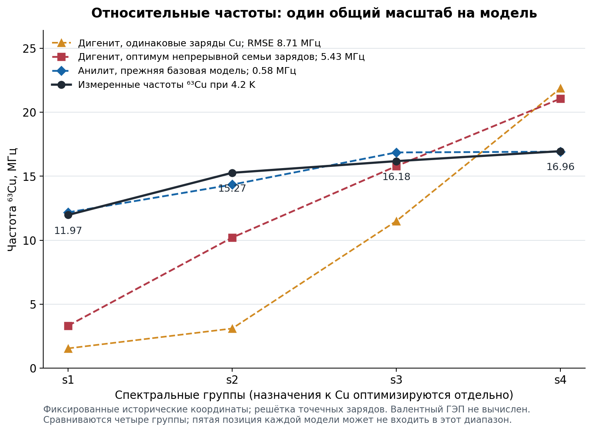
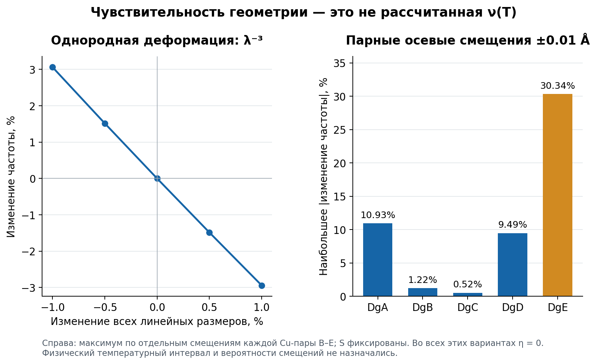
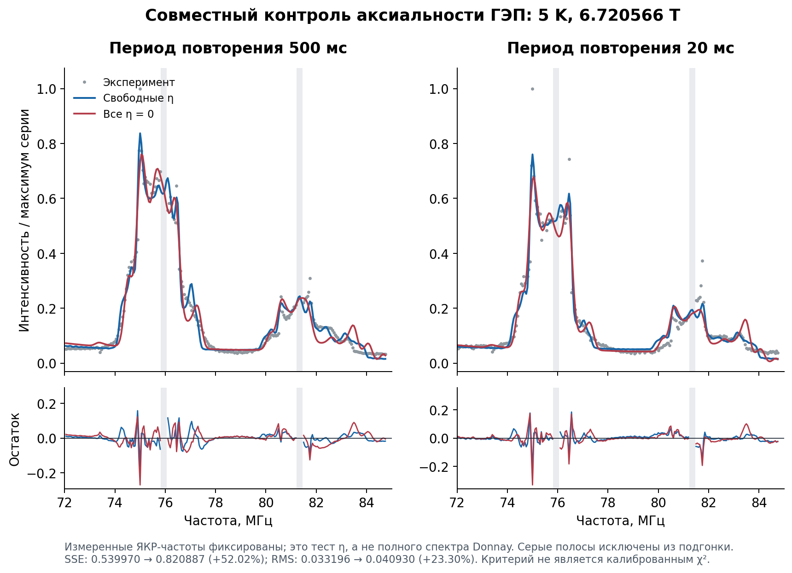

# Дигенит Donnay: расчёт ГЭП, частот ЯКР и проверка структурной гипотезы

Расчёт и анализ: 27 ноября 2026 года. Основная реализация — Java 17+, без
внешних библиотек. Все приведённые ниже частоты получены вычислением,
а не считыванием с иллюстрации или подбором отдельных частот вручную.

**Результат относится к конкретной идеализированной структуре Donnay (1958).
Её решёточные точечные заряды не воспроизводят четыре близкие измеренные
частоты 63Cu, даже после подгонки общего масштаба и перераспределения одного
дополнительного положительного заряда между всеми пятью Cu-орбитами.
Все пять локальных ГЭП этой структуры аксиальны.** Это ограничение модели,
а не опровержение всех возможных низкотемпературных структур дигенита.

Температура измерения сама по себе не определяет фазу. В существующем
экспериментальном архиве образец идентифицирован повторным XRD как анилит;
здесь дигенит проверяется как альтернативная структурная гипотеза.

## 1. Что именно задано

Взята примитивная ромбоэдрическая ячейка R-3m, №166, из работы
Donnay, Donnay, Kullerud, *American Mineralogist* **43**, 228–242 (1958).
[Исходная статья](https://msaweb.org/AmMin/AM43/AM43_228.pdf),
[COD 9000079](https://www.crystallography.net/cod/9000079.html).
Это историческая структурная гипотеза, не уточнение атомных координат при 5 K.

\[
a_r=b_r=c_r=16.16\ \mathrm{Å},\qquad
\alpha_r=\beta_r=\gamma_r=13^\circ56'=13.933333333333334^\circ.
\]

Объём равен 212.949369199442 ų. Декартова ось z направлена вдоль [111]r.

| Орбита | Дробные координаты | Число атомов в примитивной ячейке |
|---|---|---:|
| DgA | (0.5, 0.5, 0.5) | 1 |
| DgB | ±(0.060, 0.060, 0.060) | 2 |
| DgC | ±(0.133, 0.133, 0.133) | 2 |
| DgD | ±(0.250, 0.250, 0.250) | 2 |
| DgE | ±(0.350, 0.350, 0.350) | 2 |
| S0 | (0, 0, 0) | 1 |
| S1 | ±(0.2, 0.2, 0.2) | 2 |
| S2 | ±(0.4, 0.4, 0.4) | 2 |

Итого 9 Cu + 5 S, полные заселённости. DgA–DgE не являются Cu1–Cu5
анилита и не отождествляются заранее со спектральными группами s1–s4.

**Исправлена существенная неоднозначность входного CIF.** В исходном
COD-файле перечислены оба ±x-партнёра и одновременно операции инверсии;
формула файла записана как Cu17S9. Наивное расширение каждой строки
дублирует совпадающие атомы. В расчёте используются 14 уникальных атомов.
Сохранены [неизменённый оригинал](inputs/COD_9000079_original.cif),
[CIF с однократным перечислением орбит](inputs/donnay1958_unique_orbits_R-3m.cif)
и [происхождение входных данных](inputs/PROVENANCE.md).

Базовые заряды: z(Cu)=10/9 и z(S)=−2, где z=q/e. Ячейка нейтральна.
Это модель формальных точечных зарядов. Она не измеряет реальные заряды
Бейдера, степени окисления отдельных атомов или локализацию дырок.

## 2. Формулы и численный метод

Вначале вычисляется тензор решёточной суммы:

\[
G_{ab}=\sum_{j,\mathbf n}' z_j
\frac{3r_a r_b-r^2\delta_{ab}}{r^5},\qquad
\mathbf r=\mathbf R_{\mathbf n}+\mathbf r_j-\mathbf r_i.
\]

Штрих исключает собственный точечный заряд. Координаты выражены в Å,
z безразмерен; единица G — Å⁻³. Перевод в физический ГЭП:

\[
V^{\mathrm{latt}}_{ab}
=\frac{e}{4\pi\epsilon_0}10^{30}G_{ab}
=1.43996454687\times10^{21}G_{ab}\ \mathrm{V/m^2}.
\]

Используется периодическая сумма Эвальда. Для реальной части, r>0:

\[
H^{(r)}_{ab}=z_j(A r_a r_b+B\delta_{ab}),
\]

\[
A=\frac{3\operatorname{erfc}(\kappa r)}{r^5}
+\frac{6\kappa e^{-\kappa^2r^2}}{\sqrt\pi r^4}
+\frac{4\kappa^3 e^{-\kappa^2r^2}}{\sqrt\pi r^2},
\quad
B=-\frac{\operatorname{erfc}(\kappa r)}{r^3}
-\frac{2\kappa e^{-\kappa^2r^2}}{\sqrt\pi r^2}.
\]

Обратная часть и собственная поправка:

\[
G^{(k)}_{ab}=-\frac{4\pi}{\Omega}
\sum_{\mathbf k\ne0}\frac{k_a k_b}{k^2}
e^{-k^2/(4\kappa^2)}
\sum_j z_j\cos[\mathbf k\cdot(\mathbf r_i-\mathbf r_j)],
\qquad
G^{\mathrm{self}}_{ab}=\frac{4\kappa^3z_i}{3\sqrt\pi}\delta_{ab}.
\]

Векторы k содержат 2π. Использованы κ=0.15, 0.25, 0.40 Å⁻¹,
Rcut=6/κ и Kcut=12κ. Основной экспорт соответствует κ=0.25.
Границы перебора учитывают неортогональность ячейки. Суммы накапливаются
с компенсацией Kahan. Нулевая сумма диагональных компонент получается
до какого-либо искусственного удаления следа.

Симметричный тензор диагонализируется; оси выбираются так, что
|Vzz|≥|Vyy|≥|Vxx|, η=(Vxx−Vyy)/Vzz, 0≤η≤1. Для I=3/2:

\[
\nu_{\mathrm{NQR}}=\frac{e|Q V_{zz}|}{2h}
\sqrt{1+\frac{\eta^2}{3}}.
\]

Взяты Q63=−0.211 b, Q65=−0.195 b, e=1.602176634×10⁻¹⁹ C,
h=6.62607015×10⁻³⁴ J s; 1 b=10⁻²⁸ m². Эти исторические Q явно
отделены от неопределённости электронной модели. Q63=−0.220 b из
[Pyykkö (2018)](https://doi.org/10.1080/00268976.2018.1426131)
повышает все bare-частоты 63Cu на 4.2654%, не меняя их отношений или η.
Округлённые Q не предназначены для высокоточной проверки изотопного
отношения: в отдельной ЯМР-подгонке используются измеренные частоты
обоих изотопов.

### Численная проверка

В [validation_checks.csv](results/validation_checks.csv) 197 успешных
проверок: независимые эталонные суммы, изменение κ, след, тройная ось,
инверсионные партнёры, erfc и масштабирование геометрии. Максимальное
расхождение тензоров при изменении κ — 8.47×10⁻¹⁶ Å⁻³; совпадение с
независимым вычислением всех 30 Gzz — лучше 5×10⁻¹⁴ Å⁻³.
Дополнительно сохранена медленнее сходящаяся прямая сферическая сумма.
Численная точность здесь намного выше физической достоверности модели.

## 3. Частоты без эмпирического множителя

Для всех пяти Cu тройная ось требует Vxx=Vyy=−Vzz/2 и **η=0**.
Это симметрийное свойство принятой атомной модели, а не результат
подгонки η к нулю.

| Позиция | Gzz, Å⁻³ | Vzz, 10²⁰ V/m² | η | 63Cu, МГц | 65Cu, МГц |
|---|---:|---:|---:|---:|---:|
| DgA | −0.029058667 | −0.41843450 | 0 | 0.106742 | 0.098648 |
| DgB | +0.217414178 | +3.13068708 | 0 | 0.798632 | 0.738072 |
| DgC | +0.413798091 | +5.95854581 | 0 | 1.520012 | 1.404751 |
| DgD | −0.058457273 | −0.84176401 | 0 | 0.214732 | 0.198449 |
| DgE | +0.017528676 | +0.25240671 | 0 | 0.064388 | 0.059506 |

Это **bare-оценка от решётки точечных ионов**. Она не является предсказанием
полного ГЭП на ядре. В частности, не учтены собственная анизотропная
электронная плотность Cu и поляризация электронных оболочек.

Условная запись разделения вкладов:

\[
\mathbf V^{\mathrm{total}}
=(1-\gamma_\infty)\mathbf V^{\mathrm{latt}}
+(1-R_{\mathrm{val}})\mathbf V^{\mathrm{val}}.
\]

Это тензорное сложение, а не обязательное умножение всех частот на одно
число. Формула и роль обоих вкладов обсуждаются, например, в
[Gainov et al., PRB 79, 075115 (2009)](https://doi.org/10.1103/PhysRevB.79.075115),
Eq. (5). В настоящем расчёте γ∞, Rval и Vval не определялись.

Появление bare-числа 1.520 МГц у DgC само по себе не связывает эту позицию
с архивным откликом 1.5–2.2 МГц. В той области присутствует ковеллин CuS;
сигнал не был выделен как фазово чистая линия. Кроме того, тот же bare-масштаб
не описывает четыре высокочастотные группы.

## 4. Можно ли согласовать относительные частоты?

Измеренные ограничения для 63Cu при 4.2 K:

\[
(11.97,\ 15.27,\ 16.18,\ 16.96)\ \mathrm{MHz}.
\]

Сначала к дигениту перенесён ранее подогнанный для анилита масштаб
38.2916669626624 MHz на единицу |Gzz|√(1+η²/3). Получается:

| Позиция | 63Cu с перенесённым масштабом, МГц |
|---|---:|
| DgA | 1.112705 |
| DgB | 8.325151 |
| DgC | 15.845019 |
| DgD | 2.238426 |
| DgE | 0.671202 |

Это **условный перенос калибровки**, не независимые абсолютные частоты.
Отношение масштаба к bare-коэффициенту приблизительно 10.4243;
называть это найденным фактором Штернхаймера нельзя.

Затем общий положительный множитель подбирался заново для каждого
назначения четырёх измеренных групп четырём из пяти Cu-позиций.
Для заданных модельных fi:

\[
a=\frac{\sum_i f_i\nu_i^{\mathrm{obs}}}{\sum_i f_i^2},
\quad
\mathrm{RMSE}=\sqrt{\frac14\sum_i(a f_i-\nu_i^{\mathrm{obs}})^2}.
\]

Перебраны 5×4!=120 назначений на каждый из шести сценариев зарядов.
Одна позиция может отсутствовать в выбранных высокочастотных группах;
её частота также сохранена. Отдельные масштабы для отдельных Cu не вводились.

| Модель / зарядовый сценарий | Наилучший RMSE четырёх частот, МГц |
|---|---:|
| Дигенит, одинаковые Cu +10/9 | 8.708219 |
| Дигенит, дополнительный +1 на орбите DgA | 5.425976 |
| То же, на DgB | 8.174203 |
| То же, на DgC | 7.036310 |
| То же, на DgD | 7.309464 |
| То же, на DgE | 8.545324 |
| Анилит, прежняя базовая точечно-зарядовая модель | 0.584401 |

В сценариях «дополнительный +1» все Cu сначала имеют +1, затем одна
орбита получает суммарно +1: атом DgA становится +2, либо два атома другой
орбиты становятся по +1.5. S остаются −2. Все ячейки нейтральны.

### Непрерывное перераспределение заряда

Дополнительно проверена вся семья
z(Cu на орбите j)=1+w_j/m_j, где w_j≥0 и Σw_j=1, а m=(1,2,2,2,2).
Равномерный вариант входит в неё при w=m/9. Матрица M из пяти вершинных
сценариев даёт Gzz=Mw. При общем масштабе a вводится t=aw≥0:

\[
\min_{t\ge0}\|\,|M_{\mathcal I}t|-\nu^{\rm obs}\|^2
=\min_{s_i\in\{-1,+1\}}\min_{t\ge0}
\|\operatorname{diag}(s)M_{\mathcal I}t-\nu^{\rm obs}\|^2.
\]

Перебор 120 назначений ×16 наборов знаков сводит задачу к 1920
выпуклым NNLS-задачам. **Глобальный минимум этой точно определённой
семьи равен 5.425976 МГц и совпадает с вершиной w=(1,0,0,0,0).**
Это не минимум по всем возможным электронным плотностям или координатам.

Есть и независимое от оптимизатора ограничение отношений. Для любой
допустимой смеси максимальная/минимальная частота четырёх выбранных сайтов
не меньше 3.27685, если выбран DgC, и не меньше 1.96930, если DgC пропущен.
У наблюдаемых групп это отношение всего 16.96/11.97=1.41688. Границы
следуют из минимумов и максимумов линейных Gzz на зарядовом симплексе;
их расчёт сохранён в JSON непрерывного аудита.

| Измерено, МГц | Позиция в оптимуме | Рассчитано после общего масштаба, МГц |
|---:|---|---:|
| 11.97 | DgE | 3.307673 |
| 15.27 | DgA | 10.200631 |
| 16.18 | DgB | 15.788053 |
| 16.96 | DgC | 21.068145 |

Пропущенная DgD имеет 0.891738 МГц. Величина общего масштаба
60.0171938531 MHz/Å⁻³ соответствует множителю bare-частот 16.33868.
Четыре близкие экспериментальные линии не получаются даже при этой свободе.

Более низкий остаток анилитовой модели согласуется с её использованием
как рабочей гипотезы, но не доказывает атомное назначение. В прежнем расчёте
анилита параметры η не описывали совместно все ЯМР-ограничения; поэтому
расхождение между решёточным и полным электронным ГЭП остаётся существенным.



## 5. Температура и геометрическая чувствительность

Вычисление использует статические исторические координаты. Температура
4.2–5 K входит только как температура экспериментальных спектров.
Тепловое расширение, температурные внутренние координаты и колебательное
усреднение не выдумывались при отсутствии входных данных.

При однородном изменении всех расстояний r→λr:

\[
V_{ab}\to\lambda^{-3}V_{ab},\qquad
\nu\to\lambda^{-3}\nu,\qquad \eta\to\eta.
\]

| Изменение линейных размеров | Изменение частот |
|---|---:|
| −1% | +3.0610% |
| −0.5% | +1.5151% |
| +0.5% | −1.4851% |
| +1% | −2.9410% |

Это не оценка реального сжатия образца от комнатной температуры до 5 K.
Равномерная деформация вообще не улучшает относительные частоты после
повторной подгонки общего масштаба.

**Внутренние смещения могут иметь значительно больший относительный эффект.**
Каждая пара Cu B–E отдельно смещалась вдоль тройной оси на ±0.01 Å
с сохранением инверсии. Интервал отклика каждой позиции по всем этим опытам:

| Позиция | Диапазон изменения её частоты | η |
|---|---:|---:|
| DgA | −10.81…+10.93% | 0 |
| DgB | −1.22…+1.17% | 0 |
| DgC | −0.52…+0.49% | 0 |
| DgD | −9.34…+9.49% | 0 |
| DgE | −30.34…+29.48% | 0 |

Это чувствительность к отдельным статическим смещениям; она не задаёт
погрешность, вероятность смещения или температурный закон. Особенно
чувствительны малые ГЭП, возникающие из компенсации вкладов.

Угол 13.93° вместо 13°56′ даёт изменения частот от −0.214% до +1.083%
в зависимости от позиции. Результаты для этого округления тоже сохранены.

Иллюстративное поперечное парное смещение DgB на 0.01 Å нарушает тройную
ось и уже даёт η(DgB)≈0.084, η(DgD)≈0.070, η(DgE)≈0.05.
Это пример того, что **η=0 проверяет именно идеальную локальную симметрию**.
Нельзя распространять этот вывод на произвольно искажённый или вакансионно
упорядоченный дигенит. Модель смещения не релаксирована и не рассчитана
при какой-либо определённой температуре.

Для полноценного ν(T) нужны a(T), углы и внутренние координаты, данные
о распределении вакансий, электронный ГЭП и колебательное/динамическое
усреднение. При быстрых движениях усредняется взаимодействие на ядре;
статический ГЭП по средним координатам не обязан совпадать со средним
мгновенных ГЭП. Даже при низкой температуре остаются нулевые колебания.



## 6. Независимый от частотного масштаба контроль ЯМР

Рассчитан [совместный контроль всех η=0](../digenite_nmr_control/README_RU.md)
для исходных спектров при 5 K, B0=6.720566 T, периодах повторения 20 и
500 ms. В нём используются **измеренные** ЯКР-частоты, не bare-частоты
таблицы выше. Поэтому это отдельный тест аксиальности и не полный
предсказанный спектр Donnay.

Сохранены одинаковые маски, все переходы точного гамильтониана I=3/2,
свободные изотропные центры четырёх групп, общий Gaussian σ, изотопные
веса, четыре неотрицательные амплитуды и два коэффициента фона для каждой
серии. Амплитуды и фон переоптимизированы в обеих моделях.

| Критерий | Свободные η, сравниваемая архивная ветвь | Все четыре η=0 |
|---|---:|---:|
| SSE 500 ms | 0.247486 | 0.372853 |
| SSE 20 ms | 0.292484 | 0.448034 |
| Совместная SSE | 0.539970 | 0.820887 |
| Совместный нормированный RMS | 0.033196 | 0.040930 |
| Общая σ, МГц | 0.06602 | 0.13151 |
| Номинальное число параметров | 23 | 19 |

По 245 используемых точек на серию. Интенсивность каждой серии
нормирована на её собственный максимум вне масок; SSE — невзвешенная
сумма квадратов этих остатков, **не калиброванный χ²**.
Все η=0 увеличивают SSE на 52.02%, RMS на 23.30%; ухудшаются обе серии.
Аксиальная квадратура проверена до 1280 полярных точек; азимутальная
независимость подтверждена численно. Границы оптимизации не навязывали
ненулевых η: в исходной свободной модели разрешён весь диапазон [0,1].

Доказательственный предел: совместное ограничение η1=η2=η3=η4=0
описывает данные хуже в выбранной семье моделей. Не рассчитаны отдельные
профили значимости η3 и η4, не задана ковариация шума. Анизотропия
магнитного сдвига, отдельные ширины групп, распределения ГЭП и реальная
полоса возбуждения могут влиять на восстановленные η. Разброс параметров
между архивными решениями не является доверительным интервалом.



## 7. Связь с вопросами литературы 2024–2025 годов

[Yang et al., Advanced Materials 36, 2308353 (2024)](https://doi.org/10.1002/adma.202308353)
обсуждают неопределённость низкотемпературного дигенита: историческую
ромбоэдрическую модель и Na-сверхструктуры с упорядоченными вакансиями Cu.
В их исходном образце наблюдается 6a-модуляция. Это не новое уточнение
анилита Pnma при 5 K.

[King et al., DOI 10.1180/mgm.2025.10104](https://doi.org/10.1180/mgm.2025.10104)
опубликована онлайн в 2025 году, в томе 90 за 2026 год. Для природной
системы Cu–Fe–S предложены эмпирические модели сверхструктур, требующие
дополнительной проверки; иглы, предварительно названные Dg5a-R, не
различаются с анилитом по EDS. Их Fe-содержащие составы нельзя без
проверки химии отождествлять с данным лабораторным порошком.

### Что может проверить имеющийся набор спектров

1. **Достаточна ли конкретная модель с пятью аксиальными Cu?**
   Настоящий расчёт даёт отрицательный результат для частот в указанной
   точечно-зарядовой семье и ухудшение ЯМР при всех η=0. Полный электронный
   расчёт может изменить величины, но сохраняет требование η=0 на тройной
   оси, если сама электронная структура не понижает локальную симметрию.
2. **Какие конфигурации вакансий дают наблюдаемые локальные окружения?**
   Для альтернативных атомных конфигураций нужны тензоры ГЭП, затем
   совместный прогноз частот, η и порошкового спектра. Четыре резонансные
   группы дают существенно больше ограничений при совместном ЯКР+ЯМР,
   чем при сравнении только числа линий. Однако они не определяют
   уникально период 4a/5a/6a или дальний порядок.
3. **Одна фаза или несколько локальных составляющих?**
   Независимые температурные зависимости, ширины, T1/T2 и скорректированные
   интегралы могут выявить несколько семейств. Само наличие нескольких
   времен релаксации не доказывает фазовую смесь: разные позиции одной
   фазы также релаксируют по-разному.
4. **Статическое упорядочение или динамическое усреднение?**
   Серии ν(T), η(T), ширин, T1/T2 и обратимость при нагреве/охлаждении
   проверяют эту альтернативу. Разница спектров при 20 и 500 ms говорит
   о восстановлении ядерной намагниченности, но сама по себе не измеряет
   время перескока Cu между позициями.

Твиннинг, который только поворачивает один и тот же локальный тензор,
не меняет его собственных значений и частот нулевого поля. В случайном
порошке он также не создаёт новую форму распределения ориентаций.
Границы двойников и искажённые интерфейсы — отдельные локальные окружения;
для их проверки нужны оценки доли и дополнительные структурные данные.

Четыре группы не означают ровно четыре атомных позиции: оба обсуждаемых
идеальных мотива имеют пять Cu-орбит. В идеальном дигените кратности
1:2:2:2:2, в используемой анилитовой модели — 1:1:1:2:2.
Сравнивать с ними можно интегралы после поправок на T1, T2, полосу
возбуждения и чувствительность тракта, с учётом отсутствующих/перекрытых
линий. Высоты пиков и два периода повторения для этого недостаточны.

Наиболее содержательная проверяемая гипотеза для дальнейшей работы:
**локальная симметрия и набор ГЭП Cu в порошке, идентифицированном XRD
как анилит, отличаются от предсказаний идеального ромбоэдрического
мотива Donnay; они могут служить независимым критерием отбора моделей
вакансионного порядка и близких по составу Cu-сульфидных фаз.**

Ближайшее полезное улучшение спектроскопической части — ещё одно поле B0
при той же температуре и оценка анизотропного сдвига: магнитный вклад
растёт примерно как B0, а высокополевой квадрупольный сдвиг центрального
перехода — как 1/B0. Для количественного анализа следует сохранять
точную диагонализацию гамильтониана. Для структурного сравнения нужны
конкретные упорядоченные конфигурации; CIF со средними дробными
заселённостями сам по себе не даёт распределения локальных ГЭП.

## 8. Как повторить и что изменять

Из корня репозитория:

```bash
./theory/digenite_model/run.sh
```

Проверен Java-запуск через run.sh. Maven на расчётном хосте не установлен;
для обычного JDK17+ подготовлен pom.xml:

```bash
cd theory/digenite_model
mvn package
java -jar target/digenite-efg-1.0.0.jar --config=model.properties
```

Примеры альтернативных входов с отдельным выходным каталогом:

```bash
./run.sh --a=16.00 --output=results_a16 --rawTerms=false
./run.sh --angleDeg=13.93 --output=results_cod_angle --rawTerms=false
./run.sh --q63Barn=-0.220 --output=results_Q220 --rawTerms=false
./run.sh --x.DgB=0.0602 --output=results_shift_B --rawTerms=false
```

Это изменение заданных параметров, а не автоматическое построение
температурной структуры. Позиции S остаются 0, ±0.2, ±0.4; для другой
атомной модели следует явно изменить её входной мотив в Java-классе.

Дополнительный непрерывный аудит и графики, Python + NumPy/SciPy/Matplotlib:

```bash
python theory/digenite_model/analysis/continuous_charge_nnls.py
python theory/digenite_model/analysis/plot_results.py
```

## 9. Карта результатов

| Файл / каталог | Назначение |
|---|---|
| `model.properties` | Все используемые параметры основного расчёта |
| `src/main/java/org/eljah/nmr/DigeniteEfg.java` | Реализация Эвальда, тензоров, частот, назначений и чувствительности |
| `results/tensors_and_frequencies_30.csv` | Полные тензоры, главные значения, η и частоты 6×5 |
| `results/alpha_convergence_subtotals.csv` | 90 строк с real, reciprocal и self-частями |
| `results/raw_*_uniform_mainalpha.csv.gz` | Каждый отдельный вклад основной решёточной суммы |
| `results/assignments_all720.csv` | Все дискретные назначения четырёх линий |
| `results/assignments_best6.csv` | Лучшее назначение для каждого зарядового сценария |
| `results/continuous_charge_optimum.json` | Оптимум непрерывной семьи зарядов |
| `results/sensitivities_uniform_charges.csv` | 85 результатов геометрической чувствительности |
| `results/expanded_atoms.csv`, `charges.csv`, `cell_vectors.csv` | Полностью развёрнутые численные входы |
| `results/near_neighbors_lt5A.csv` | Ближайшие окружения с трансляциями |
| `results/validation_checks.csv` | Проверки численной корректности |
| `figures/` | Графики сопоставления и температурной чувствительности |
| `../digenite_nmr_control/` | Дополнительный контроль аксиальности по исходным ЯМР-данным |

Точное совпадение повторного численного запуска с CSV проверяет реализацию
математической модели. Физическая проверка требует электронного ГЭП,
температурной структуры и независимых спектральных ограничений.
