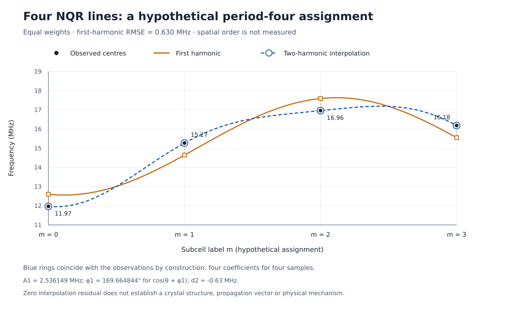

# Одна Cu-позиция и четыре окружения в сверхструктуре

Расчёт и литературный разбор: **27 ноября 2026 года**.
Модуль **Java 17 / Maven**, без внешних библиотек.

Проверяется конкретная версия гипотезы: четыре наблюдаемых центра
⁶³Cu-ЯКР **11.97, 15.27, 16.18, 16.96 MHz** могут происходить от
одной родительской Cu-орбиты, потерявшей эквивалентность в сверхструктуре.
Это не присвоение s1–s4 известным Cu1–Cu5 и не определение структуры
по четырём числам.

## Результат

Для скалярной первой гармоники частоты с периодом четыре исходные ячейки

\[
\nu_m=\nu_0+b\cos(\pi m/2)+c\sin(\pi m/2),\qquad m=0,1,2,3,
\]

перебраны все **24 назначения** частот подячейкам. Глобальный минимум
невзвешенного RMSE — **0.630 MHz**. Представитель восьми эквивалентных
лучших порядков: **11.97, 15.27, 16.96, 16.18 MHz**.

| m | Наблюдение, MHz | Первая гармоника, MHz | Расчёт − наблюдение, MHz |
|---:|---:|---:|---:|
| 0 | 11.97 | 12.60 | +0.63 |
| 1 | 15.27 | 14.64 | −0.63 |
| 2 | 16.96 | 17.59 | +0.63 |
| 3 | 16.18 | 15.55 | −0.63 |

Коэффициенты: ν0=15.095, b=−2.495, c=−0.455 MHz;
амплитуда A=2.536148654949 MHz, фаза в конвенции
`A*cos(theta+phi)` равна 169.664843652464°.

Добавление `−0.630*cos(2*theta)` интерполирует все четыре числа точно.
Однако это **четыре коэффициента на четыре наблюдения**. Нулевой остаток
не устанавливает период, атомные координаты, CDW или высокотемпературную
частоту. ν0=15.095 MHz — среднее четырёх данных при их температуре,
а не предсказание линии выше перехода.



### Почему это не исключает общую сверхструктурную гипотезу

При I=3/2 для чистого квадрупольного гамильтониана

\[
\nu_{\rm NQR}^2=\frac{(eQ)^2}{6h^2}\operatorname{Tr}(\mathbf V^2).
\]

Поэтому первая гармоника **тензора ГЭП** в общем случае даёт более
сложную зависимость **частоты**. Скалярная проверка выше имеет более
узкую область применимости.

Одно изменение η при неизменном |Vzz| недостаточно:
максимальное отношение частот √(4/3)=1.15470054,
наблюдаемое 16.96/11.97=1.41687552.
Требуется также изменение |Vzz|, минимум в **1.22705020** раза.
Эта граница не определяет величину атомного смещения или перенесённого заряда.

### Проверка по реально сохранённым ν(T)

В архивном Origin-проекте имеются **24 температуры от 4.2 до 290 K,
18 полных квартетов**; последний полный квартет — при 270 K.
Его частоты **11.44, 14.52, 15.60, 15.18 MHz** остаются разделёнными.
Размах уменьшается с 4.99 до 4.16 MHz; RMS расщепления относительно
невзвешенного среднего — с 1.90077 до 1.63091 MHz.
Полного схождения четырёх ветвей в доступном диапазоне нет.

s4 снижается на 10.50%, остальные ветви — примерно на 3.58–4.91%.
Следовательно, одно общее изотропное тепловое масштабирование не описывает
номинальные данные. При этом общий родитель выше исследованного диапазона
или переход первого рода не исключаются. Пропуски s4 при 180–220 K
не позволяют объявить сближение s3/s4 разрешённым физическим пересечением.

Подробный расчёт, формулы и график:
[TEMPERATURE_ANALYSIS_RU.md](TEMPERATURE_ANALYSIS_RU.md).
Исходные 65Cu-колонки этой таблицы вычислены из 63Cu/1.081 и не приняты
за независимые изотопные измерения.

## Где формулы, промежуточные шаги и литература

| Файл | Содержание |
|---|---|
| [ANALYTIC_NOTES_RU.md](ANALYTIC_NOTES_RU.md) | Расщепление орбиты, кратности, тензорная модуляция, вывод минимума первой гармоники, точная интерполяция, несоизмеримый спектр, динамика и двойники |
| [LITERATURE_AND_INTERPRETATION_RU.md](LITERATURE_AND_INTERPRETATION_RU.md) | Проверенные частоты купратов, Cu2F-splitting в YBCO, Cu-вакансионный порядок, CDW и сверхпроводимость Cu–S; первичные DOI и точные места в статьях |
| [TEMPERATURE_ANALYSIS_RU.md](TEMPERATURE_ANALYSIS_RU.md) | Температурный размах, RMS расщепления, общий тепловой масштаб и фиксированное назначение подъячеек |
| [TEMPERATURE_DATA_PROVENANCE_RU.md](TEMPERATURE_DATA_PROVENANCE_RU.md) | Исходный Git blob/хеш, метаданные Graph5, выбор колонок, пропуски и неоднозначность прослеживания ветвей |
| [SupercellNqr.java](src/main/java/org/eljah/nmr/SupercellNqr.java) | Полный исходный код нового расчёта |
| [TemperatureSeries.java](src/main/java/org/eljah/nmr/TemperatureSeries.java) | Обработка температурной таблицы без интерполяции пропусков |
| [all_orders.csv](results/all_orders.csv) | Все 24 назначения, коэффициенты и остатки |
| [opposite_pairs.csv](results/opposite_pairs.csv) | Три разбиения на противоположные пары, суммы и аналитические минимумы |
| [best_order_samples.csv](results/best_order_samples.csv) | Исходные числа и обе модели для лучшего представителя |
| [tensor_invariants.csv](results/tensor_invariants.csv) | ν² и Tr(W²)=6ν² при W=(eQ/h)V в MHz; полный тензор из этого не восстанавливается |
| [summary.json](results/summary.json) | Параметры, единицы, ограничения интерпретации и итог проверок |
| [temperature_metrics.csv](results/temperature_metrics.csv), [temperature_summary.json](results/temperature_summary.json) | Температурные метрики всех полных квартетов и условия расчёта |
| [validation_checks.csv](results/validation_checks.csv) | 22 численные проверки: ортогональная проекция, нормальные уравнения, парный контраст, тензорный инвариант и повороты |
| [four_subcells.svg](figures/four_subcells.svg) | Векторный график, непосредственно созданный Java-программой |
| [CALCULATION_MANIFEST.json](CALCULATION_MANIFEST.json) | Хеши файлов этого модуля и сведения о воспроизведении |

Связанный расчёт другой гипотезы — фиксированной структуры Donnay:
[полный аналитический вывод](../digenite_model/ANALYTIC_DERIVATION_RU.md),
[численный отчёт](../digenite_model/README_RU.md).
Его неудача не заменяет проверку возможных новых сверхструктур.

## Запуск в Windows / IntelliJ IDEA

Открыть `pom.xml` как Maven-проект, выбрать JDK 17 или новее.
Рабочая папка для запуска — `theory/superstructure_hypothesis`.
Главный класс: `org.eljah.nmr.SupercellNqr`.

В терминале из этой папки:

```text
mvn package
java -jar target/superstructure-hypothesis-1.0.0.jar
java -cp target/superstructure-hypothesis-1.0.0.jar org.eljah.nmr.TemperatureSeries
```

Таблицы сохраняются в `results`, график — в `figures/four_subcells.svg`.
Без Maven можно запустить `run.cmd` при установленном JDK.
Для Linux/macOS предусмотрен `sh run.sh`.
Эти сценарии — дополнительные способы запуска того же исходника;
Gradle и сторонние библиотеки не используются.

Параметры командной строки:

```text
java -jar target/superstructure-hypothesis-1.0.0.jar --help
java -jar target/superstructure-hypothesis-1.0.0.jar --frequencies=11.97,15.27,16.18,16.96 --output=results --figure=figures/four_subcells.svg
```

Нужны четыре положительных значения в MHz, разделённые запятыми;
десятичный разделитель — точка. Все частоты получают одинаковый вес:
ошибки центров и ковариационная матрица не были переданы.

## Проверка и физические ограничения

На расчётном хосте выполнены компиляция и запуск через OpenJDK 21.0.13.1;
код компилируется с целевым форматом Java 17. **22 проверки квартета
и 8 температурных проверок прошли**.
Maven на хосте отсутствует, поэтому Maven-сборка и Windows-сценарий здесь
не выполнялись. `pom.xml` не имеет внешних вычислительных зависимостей.

Из четырёх центров не выводятся статистическая значимость модели,
пространственный порядок атомов, высокотемпературная группа,
температура перехода, реальные заряды, электронная щель или Tc.
Для проверки общего родителя нужны температурные ветви, поправленные
интенсивности, ограничения η и независимая дифракционная структура.
Программа не меняет исходные экспериментальные файлы.
