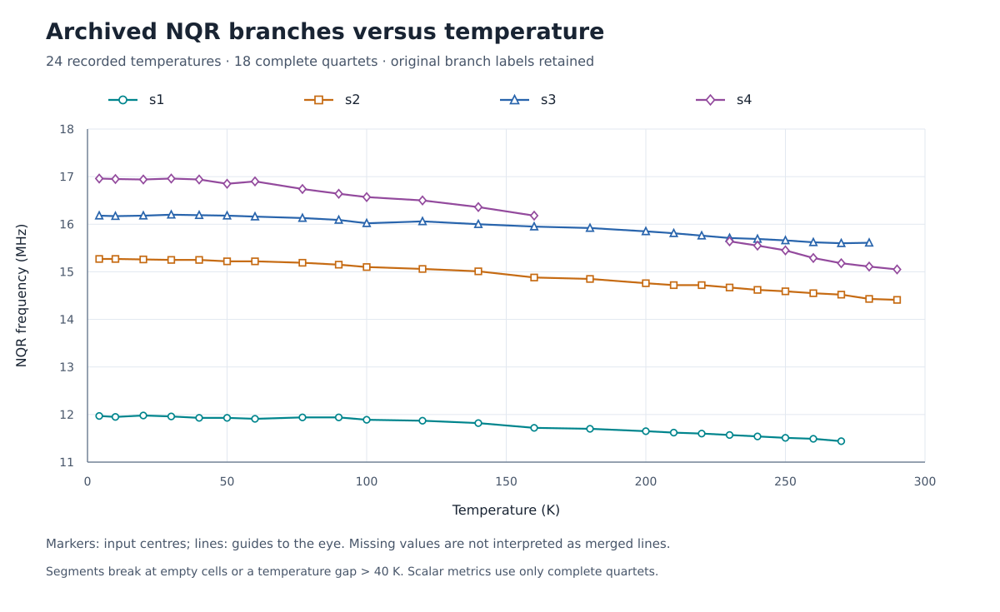

# Что температурные данные говорят о едином родительском Cu-сайте

Дата анализа: 27 ноября 2026 года.

В архиве сохранены численные частоты всех четырёх спектральных ветвей,
извлечённые из встроенного Origin-проекта. Поэтому здесь используется
реальная табличная ν(T), а не модель теплового расширения и не оцифровка
рисунка. Происхождение, исторические названия и точные правила переноса:
[TEMPERATURE_DATA_PROVENANCE_RU.md](TEMPERATURE_DATA_PROVENANCE_RU.md).

## 1. Какие данные сравниваются

Источник содержит 24 температуры от 4.2 до 290 K; полные квартеты
имеются при 18 температурах, последний — при 270 K. s1–s4 сохранены
в исходном порядке; это спектральные метки, не кристаллографическое
назначение. Номинальные подписи легенды местами отличаются от чисел
таблицы; ниже использованы численные ячейки.

| T, K | s1, MHz | s2, MHz | s3, MHz | s4, MHz |
|---:|---:|---:|---:|---:|
| 4.2 | 11.97 | 15.27 | 16.18 | 16.96 |
| 77 | 11.94 | 15.19 | 16.13 | 16.74 |
| 160 | 11.72 | 14.88 | 15.95 | 16.18 |
| 230 | 11.57 | 14.67 | 15.71 | 15.64 |
| 270 | 11.44 | 14.52 | 15.60 | 15.18 |

s4 отсутствует при 180, 200, 210 и 220 K. При 280 K нет s1;
при 290 K нет s1 и s3. Пропуски не заменяются интерполяцией.
Данные при 300 K в этом численном наборе отсутствуют, хотя ось
исходного графика простирается выше 300 K.

## 2. Метрики расщепления, не зависящие от перестановки ветвей

Для каждого полного квартета определены

\[
\bar\nu(T)=\frac14\sum_{i=1}^4\nu_i(T),\qquad
\Delta_{\rm span}(T)=\max_i\nu_i-\min_i\nu_i,
\]

\[
D(T)=\sqrt{\frac14\sum_i[\nu_i(T)-\bar\nu(T)]^2},\qquad
d(T)=D(T)/\bar\nu(T).
\]

Это описательные метрики с одинаковыми весами четырёх центров. D не является
шириной отдельной линии, ошибкой среднего или напрямую установленным
параметром порядка. Среднее не взвешено кратностями или исправленными
интенсивностями, поскольку такие веса здесь не определены.

| T, K | Среднее, MHz | Размах, MHz | D, MHz | D/среднее |
|---:|---:|---:|---:|---:|
| 4.2 | 15.0950 | 4.9900 | 1.90077 | 0.125920 |
| 77 | 15.0000 | 4.8000 | 1.85096 | 0.123397 |
| 160 | 14.6825 | 4.4600 | 1.77936 | 0.121189 |
| 230 | 14.3975 | 4.1400 | 1.68341 | 0.116924 |
| 270 | 14.1850 | 4.1600 | 1.63091 | 0.114974 |

**Полного схождения квартета в доступном диапазоне нет.** При 270 K
размах всё ещё 4.16 MHz. Нормированное расщепление уменьшается умеренно,
а не стремится к нулю в пределах измеренного интервала.
Это не опровергает общего родителя выше исследованного диапазона или
перехода первого рода, при котором плавного схождения вообще может не быть.

## 3. Почему одного общего теплового масштаба недостаточно

При неизменных относительных координатах и точечных зарядах изотропное
изменение всех расстояний даёт

\[
\nu_i(T)=s(T)\nu_i(T_0),\qquad s(T)=\lambda(T)^{-3}.
\]

Тогда все относительные изменения частот одинаковы, все отношения
\(\nu_i/\nu_j\) постоянны и d(T) неизменно.
В табличных данных от 4.2 до 270 K:

| Ветвь | Относительное изменение частоты |
|---|---:|
| s1 | −4.43% |
| s2 | −4.91% |
| s3 | −3.58% |
| s4 | −10.50% |

Таким образом, номинальная таблица не описывается одним общим
изотропным масштабом. Это не доказывает электронную CDW: внутренние
координаты, анизотропное расширение, электронный вклад, вакансии и
колебательные поправки могут иметь разную температурную зависимость.
Погрешностей центров в таблице нет, поэтому здесь не назначается
уровень статистического исключения.

## 4. Гармонические коэффициенты при фиксированном назначении

Для сравнения формы квартета оставлено одно и то же гипотетическое
назначение на всех температурах:

\[
(f_0,f_1,f_2,f_3)=(s1,s2,s4,s3).
\]

Это выбранный при 4.2 K представитель лучшей скалярной первой гармоники,
а не измеренный пространственный порядок атомов. На каждой температуре
назначение заново не оптимизируется и ветви не сортируются по частоте.

\[
\nu_0=\frac{f_0+f_1+f_2+f_3}{4},\quad
b=\frac{f_0-f_2}{2},\quad c=\frac{f_1-f_3}{2},\quad
d_2=\frac{f_0-f_1+f_2-f_3}{4}.
\]

Первогармонический RMSE для данного назначения равен |d2|.

| T, K | b, MHz | c, MHz | d2, MHz | RMSE первой гармоники, MHz |
|---:|---:|---:|---:|---:|
| 4.2 | −2.495 | −0.455 | −0.6300 | 0.6300 |
| 77 | −2.400 | −0.470 | −0.6600 | 0.6600 |
| 160 | −2.230 | −0.535 | −0.7325 | 0.7325 |
| 230 | −2.035 | −0.520 | −0.7925 | 0.7925 |
| 270 | −1.870 | −0.540 | −0.8750 | 0.8750 |

Профиль частот меняется, а не просто масштабируется одним множителем.
Коэффициенты частот не следует отождествлять с гармониками электронной
плотности или атомных смещений: отображение тензора ГЭП в частоту нелинейно.

## 5. Что означает сближение s3/s4

При 160 K табличная s4 выше s3 на 0.23 MHz, при 230 K она ниже на
0.07 MHz. Между этими точками s4 отсутствует. Поэтому данные устанавливают
смену частотного порядка **архивных меток**, но не разрешённое наблюдение
физического пересечения двух однозначно прослеженных состояний.

Возможны пересечение, перекрытие, неоднозначность отслеживания или иной
спектральный эффект. Нужно вернуться к спектрам и условиям возбуждения
в этой области. Само сближение двух верхних линий при сохраняющемся
разрыве до s1/s2 не является восстановлением единой родительской позиции
для всего квартета.

## 6. Воспроизведение и границы

Обработка выполнена отдельным Java-классом
[TemperatureSeries.java](src/main/java/org/eljah/nmr/TemperatureSeries.java).
Вход: [temperature_series.csv](inputs/temperature_series.csv).
Все полные строки и промежуточные метрики:
[temperature_metrics.csv](results/temperature_metrics.csv).
Машиночитаемые настройки и итог:
[temperature_summary.json](results/temperature_summary.json).
Команды запуска приведены в [README_RU.md](README_RU.md).

Оригинал и адаптер сохраняют числа без округления. Колонки 65Cu исходной
таблицы рассчитаны как соответствующие 63Cu/1.081 и не используются как
независимое изотопное измерение. Три архивные копии таблицы представляют
один численный набор, а не три независимых эксперимента.

Для гипотезы единого родителя остаётся проверить изменение полного
семейства ГЭП при реально наблюдаемом структурном переходе, с поправками
интенсивностей и контролем фазового состава. Произвольная экстраполяция
сохранившихся двух линий при 290 K не заменяет этой проверки.
